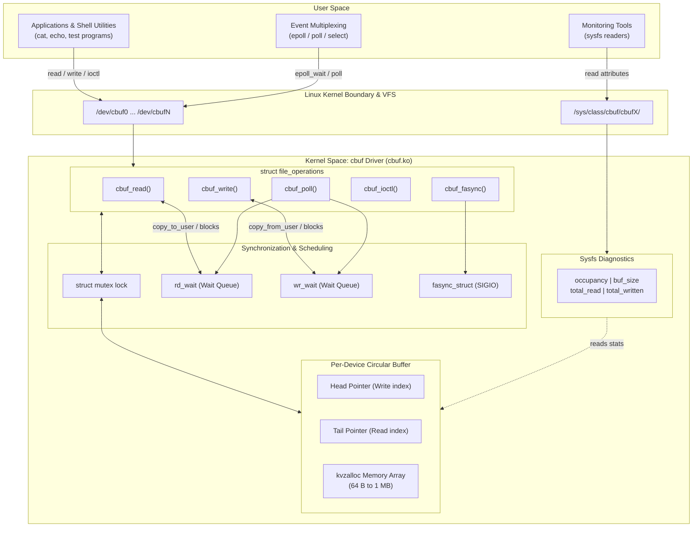

# cbuf

Linux character device driver providing circular buffer FIFOs under `/dev/cbuf0`, `/dev/cbuf1`, etc.

Data written to a device is held in a kernel circular buffer and can be read back sequentially. Reading from an empty buffer blocks until data is available, and writing to a full buffer blocks until space is freed. Non-blocking I/O (`O_NONBLOCK`) and multiplexing (`poll`/`epoll`/`select`) are also supported.

## Architecture



## Build

Requirements: kernel headers (`linux-headers` or `kernel-devel`) and gcc.

```sh
make
```

Or run `./build.sh`.

## Loading and Usage

Insert the module:

```sh
sudo ./load.sh
```

By default this registers 4 devices with 4096-byte buffers (`/dev/cbuf0` to `/dev/cbuf3`). You can pass arguments to change the count and buffer size:

```sh
# 2 devices, 8192 bytes each
sudo ./load.sh 2 8192
```

Test it with standard shell commands:

```sh
# terminal 1
cat /dev/cbuf0

# terminal 2
echo "test message" > /dev/cbuf0
```

Readings and writes update runtime counters exposed through sysfs:

```sh
cat /sys/class/cbuf/cbuf0/occupancy
cat /sys/class/cbuf/cbuf0/total_written
cat /sys/class/cbuf/cbuf0/total_read
cat /sys/class/cbuf/cbuf0/buf_size
```

Unload the module when finished:

```sh
sudo ./unload.sh
```

## ioctl Commands

Userspace programs can include `cbuf.h` to interact with device ioctls:

- `CBUF_IOC_FLUSH` drops all buffered data and resets read and write pointers.
- `CBUF_IOC_STATS` reads current buffer occupancy, total read/written bytes, and active reader/writer counts into `struct cbuf_stats`.
- `CBUF_IOC_RESIZE` changes the buffer capacity at runtime (powers of two between 64 and 1048576 bytes). Fails with `EBUSY` if current occupancy exceeds the requested size.

## Implementation Details

- Devices are allocated dynamically using `alloc_chrdev_region`.
- Each device holds its own buffer, mutex, wait queues (`rd_wait`, `wr_wait`), and stats struct. There is no shared global buffer state.
- `open()` uses `container_of(inode->i_cdev, struct cbuf_device, cdev)` and stores the pointer in `file->private_data`.
- Buffers are allocated with `kvzalloc` to support sizes larger than a single page cleanly.
- `fasync` is implemented so applications can request `SIGIO` notifications on data availability.

## License

GPLv2
